# cacography

*cacography* (n.): bad handwriting, on purpose.

Write your notes in LaTeX and get back a phone photo of them handwritten on a slightly abused sheet of paper, with crossouts, coffee rings and all. The PDF underneath stays searchable, so nobody has to know. ;)

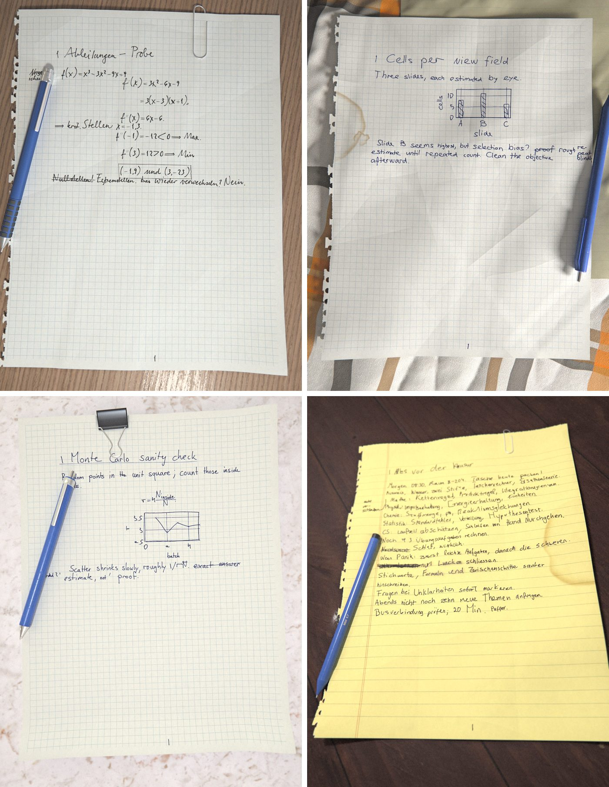

Every word is written by a handwriting model trained on real pen recordings. Each photo is traced in 3D (paper, desk, lamp, pen). LaTeX still does the layout, the maths and the figures.

## From this to this

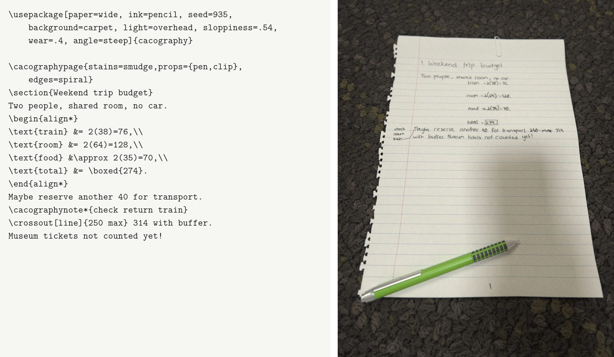

## Install

You need LuaLaTeX ([TeX Live](https://tug.org/texlive) or [MiKTeX](https://miktex.org)). Then, from this folder:

```bash
.\install.ps1        # Windows
sh install.sh        # macOS, Linux
```

The installer brings its own Python (via [uv](https://docs.astral.sh/uv)), installs the renderer, puts the LaTeX package where TeX finds it, fetches the handwriting models and runs `cacography doctor` to check everything. Allow for a few GB of download, mostly PyTorch. Already have PyTorch? Activate that environment first (`conda activate base`) and the installer uses it instead. An NVIDIA GPU is optional. Without one, pages are photographed with formulas instead of traced in 3D: no props, simpler light.

## Use

```bash
cacography notes.tex
```

Or press Compile in your editor. Compile with LuaLaTeX and shell escape on, twice, as you would for references. The first run draws the pages and the second puts them in.

- **TeXstudio:** put these two lines at the top of the file. TeXstudio asks once whether to allow them.
  ```latex
  % !TeX program = lualatex
  % !TeX TXS-program:compile = txs:///lualatex/[--shell-escape]
  ```
- **VS Code (LaTeX Workshop), latexmk:** copy [`.latexmkrc`](https://github.com/aynader/cacography/blob/main/.latexmkrc) next to your file. It reruns by itself.
- **TeXworks, Texmaker, others:** add `-shell-escape` to the LuaLaTeX command.
- **Overleaf:** no. The pages are drawn by a program on your computer.

Start from [`examples/notes.tex`](https://github.com/aynader/cacography/blob/main/examples/notes.tex). Only pages that changed are drawn again.

## Options

```latex
\usepackage[paper=graph, ink=pencil, light=window, crumple=0.6, seed=42]{cacography}
```

Anything you don't set is picked at random from the `seed`. Each part has its own seed, so pinning one part never reshuffles another. `\cacographypage{crumple=1, stains=coffee}` changes just the sheet it lands on. In each row below, only the named option changes.

### The writing

**`seed`**: a different writer (and room) for each number.
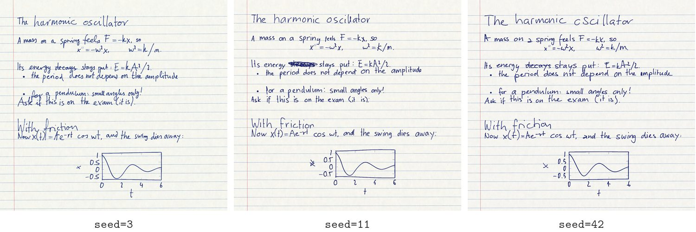

**`sloppiness`**: 0 to 1, from neat, even lines to words that change size, tilt and wander off the line.
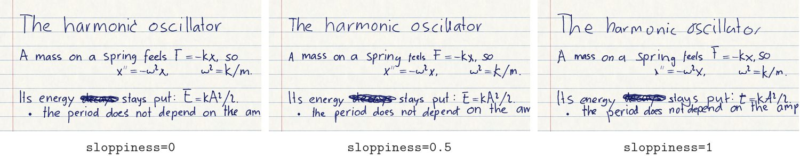

**`ink`**: `blue`, `black`, `red` (ballpoint), `pencil`.
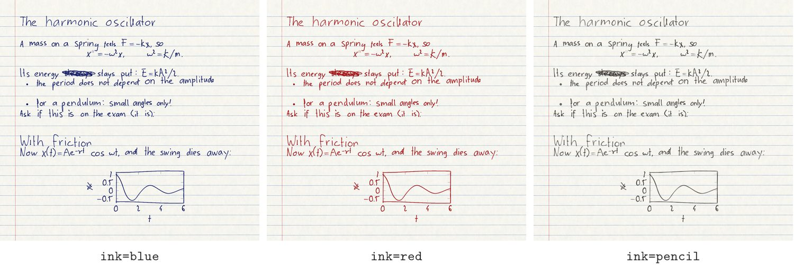

**`paper`**: `notebook`, `wide`, `graph`, `legal` (yellow pad), `blank`.
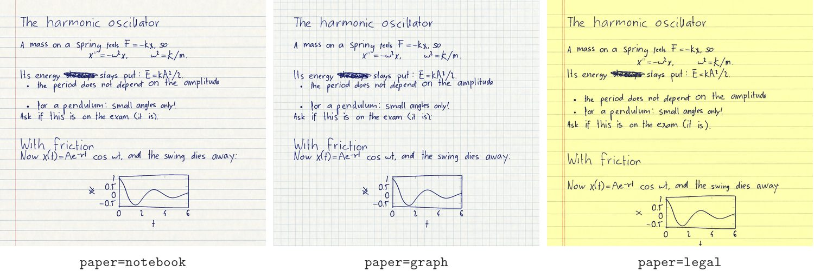

**`underline`**: `headings` underlines section titles by hand.
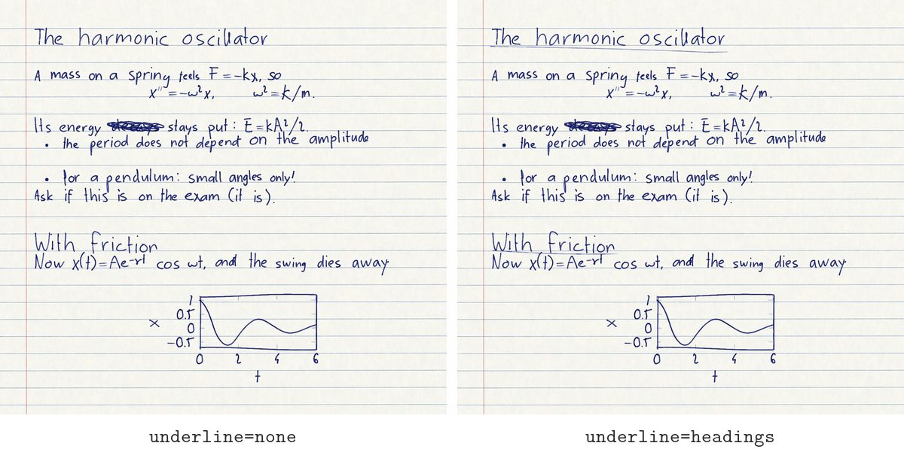

### The photo

**`camera`**: `phone`, `scan`, `none` (just the paper).
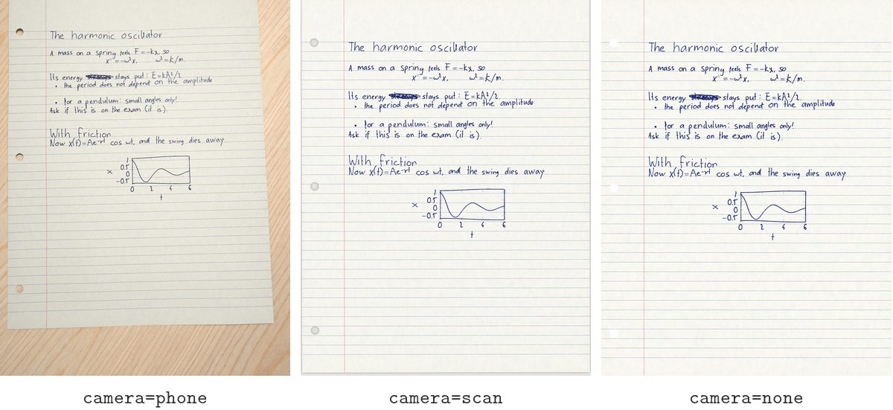

**`background`**: 30-odd desks and fabrics (`oak`, `walnut`, `marble`, `concrete`, `denim`, `plaid`, `cork`, …), a group (`wood`, `fabric`, `stone`), or `file:my-desk.jpg`.
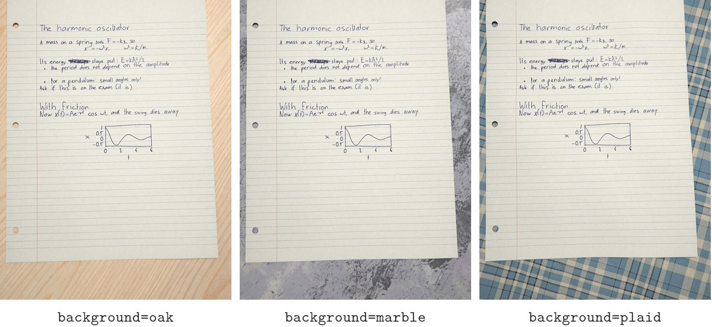

**`light`**: `lamp`, `overhead`, `window`, `soft`, `raking`, `flash`, `dim`.
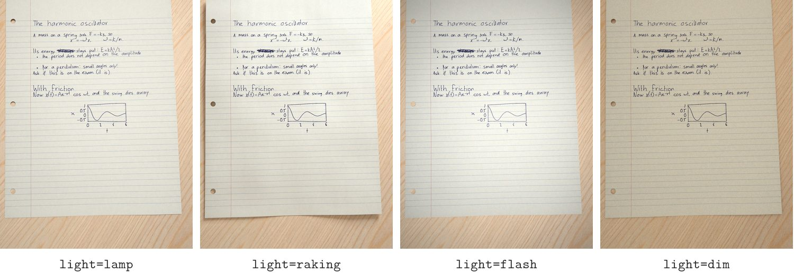

**`angle`**: `flat`, `slight`, `steep`, or degrees.
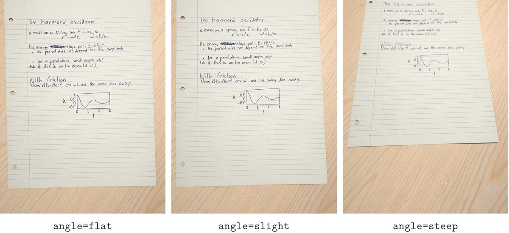

**`framing`**: `tight`, `loose`, `cropped`.
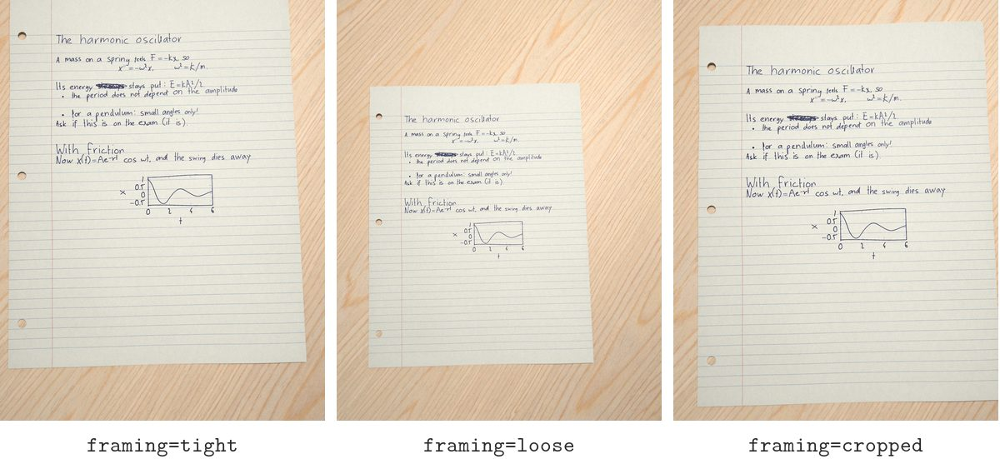

**`shadow`**: `none`, or `phone` (your phone and hand, blocking the light).
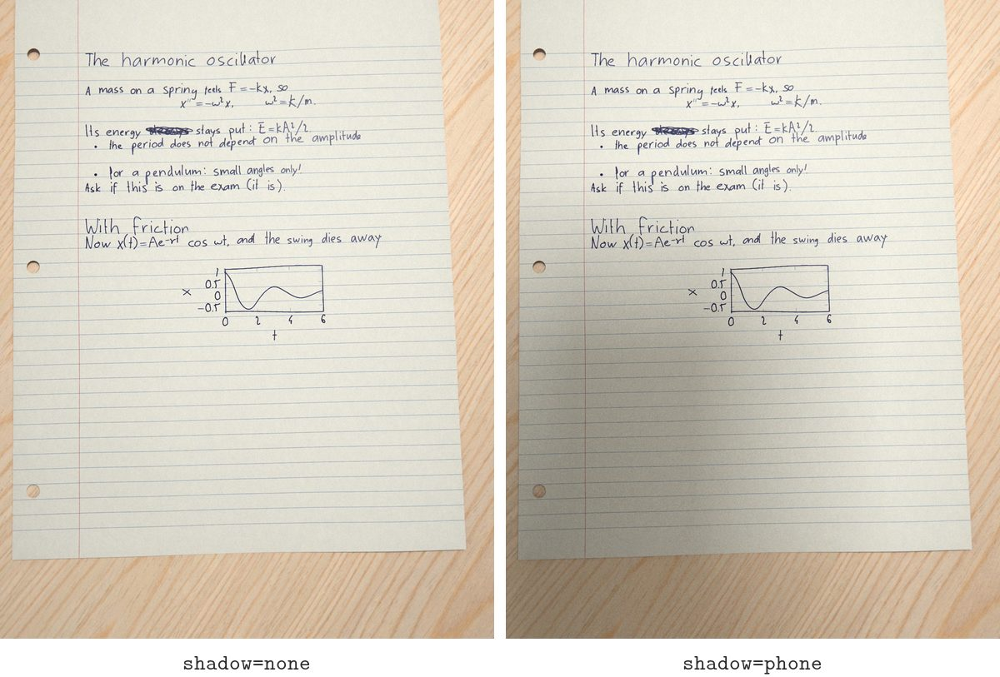

**`props`**: any of `tape`, `clip`, `binder`, `staple`, `pen`, `sheet`. Pens come in a dozen kinds, and pencil ink brings a pencil.
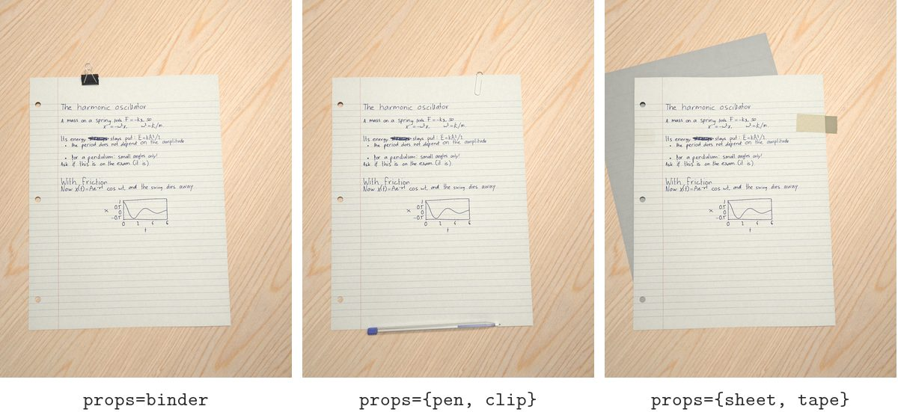

### The sheet

**`crumple`**: `none`, or 0 to 1 (balled up and smoothed out again).
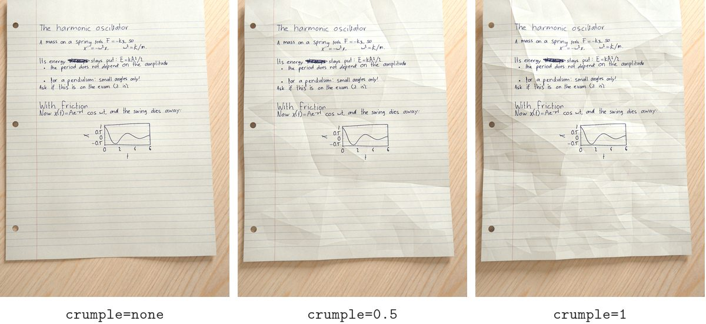

**`folds`**: `half`, `thirds`, `quarters`. **`creases`**, **`scores`** (thin pressed lines): how many.
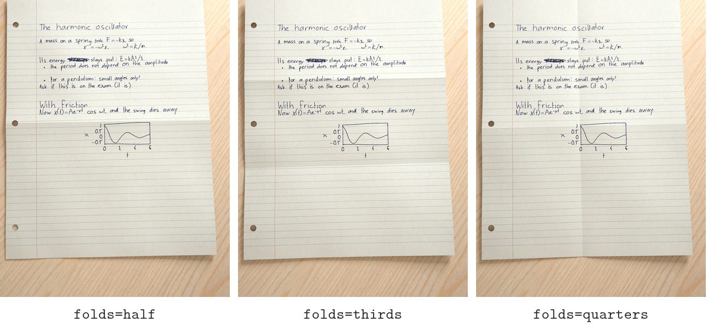
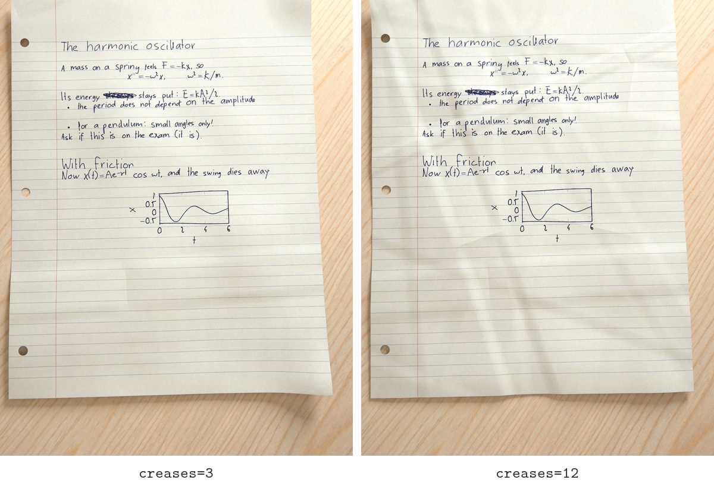

**`edges`**: `clean`, `worn`, `torn`, `spiral`.
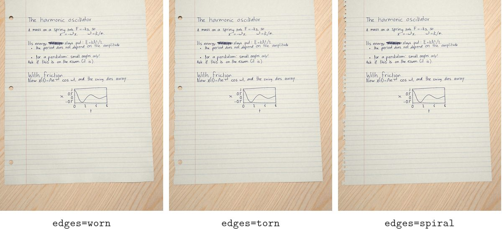

**`stains`**: `coffee`, `water`, `smudge` (ink dragged by a hand), or several: `stains={coffee, smudge}`.
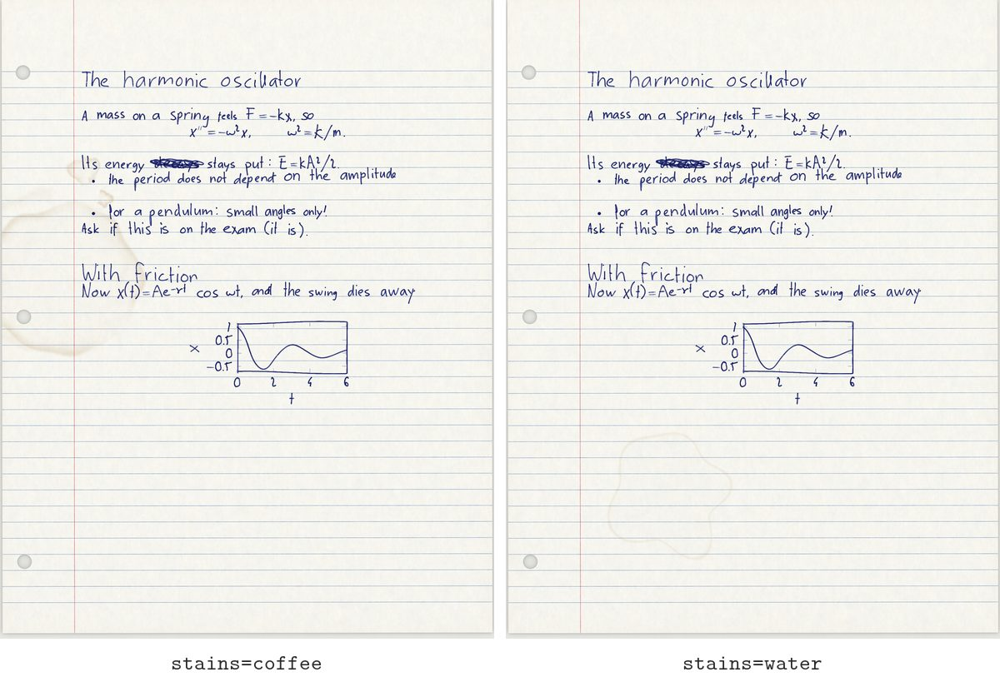

**`grooves`**: 0 to 1, how hard the pen pressed into the paper, with faint grooves from writing on the sheet above. Subtle on purpose; it shows in raking light, up close.

**`curl`**: 0 to 1, edges and corners rolling up.
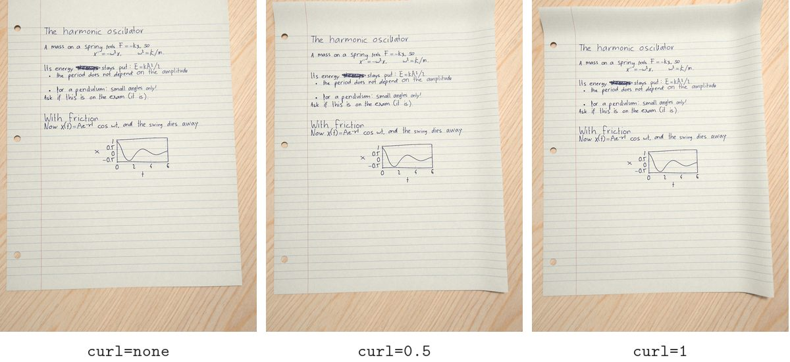

**`age`**: 0 to 1, yellowed and faded.
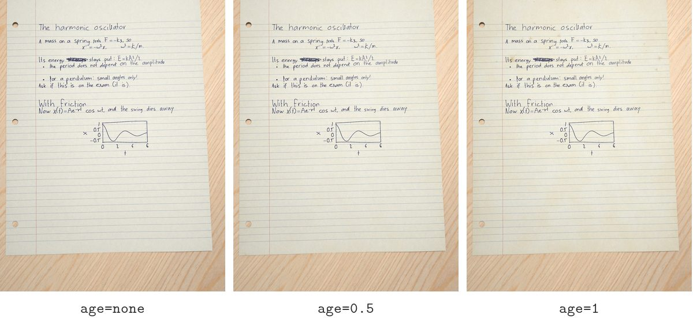

**`backside`**: `writing` shows the back of the sheet through.


**`wear`**: 0 to 1, how likely everything in this section is when left random.
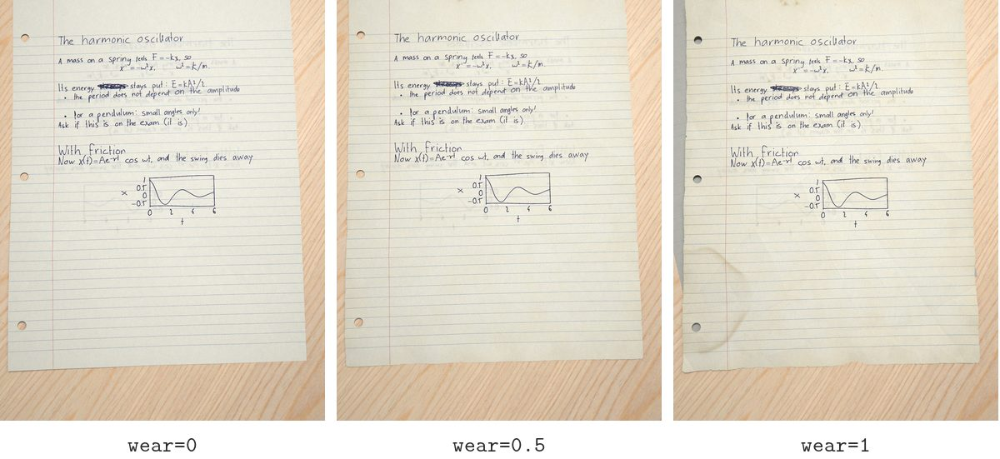

## Commands

Corrections are written the way people make them. Each picture below shows the LaTeX beside what it wrote.

**`\crossout[line|double|scribble]{text}`**
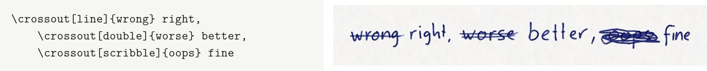

**`\erased{old}{new}`**: rubbed out and written over; best with `ink=pencil`.
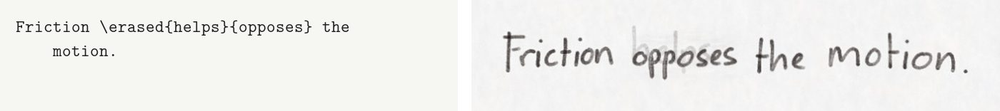

**`\cacographynote{text}`**: a margin note; with `*`, an arrow to where it belongs; with `[right]`, in the right margin.
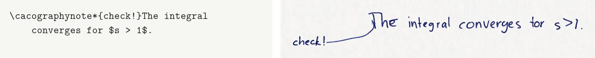

**`\boxed`, `\underline`, `\fbox`**: drawn by hand.
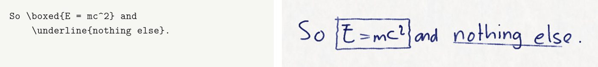

**TikZ and pgfplots**: every line, curve, label and hatch drawn again by hand.
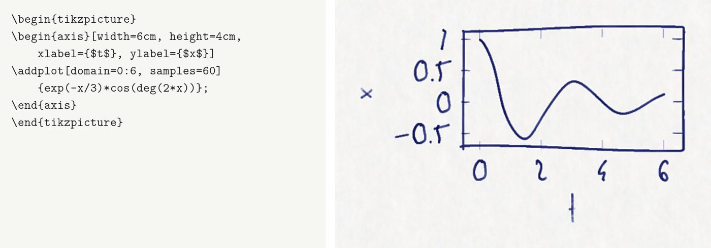

**`\reroll[n]{word}`**: one badly written word written again, leaving the rest of the page alone.
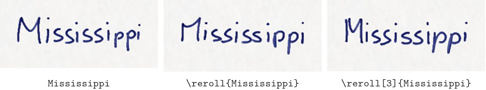

## How it works

1. **LuaLaTeX** lays the page out at handwriting proportions (letters 10% wider, word gaps 2.3× wider), so lines break where a hand would. It records where every glyph, rule and drawing goes.
2. **The writer**, an LSTM with a mixture-density output, writes each word. A reader trained alongside it reads the word back, and anything that doesn't read as its text is written again. Maths symbols come from real handwritten samples.
3. **The ink** is laid down like a ballpoint's: heavier on downstrokes, pooling where the pen lands, skipping now and then. It goes onto paper with grain, ruling, holes, folds and stains.
4. **The camera** traces the sheet in 3D with [Mitsuba 3](https://www.mitsuba-renderer.org): bent paper, a real lamp, props, the phone's own processing and JPEG. The photo goes back into the PDF over the invisible typeset text.

The model, datasets and training recipe are in [`training/`](https://github.com/aynader/cacography/blob/main/training/README.md). Trained on [BRUSH](https://github.com/brownvc/decoupled-style-descriptors#brush-dataset), [IAM-OnDB](https://fki.tic.heia-fr.ch/databases/iam-on-line-handwriting-database) and [MathWriting](https://github.com/google-research/google-research/tree/master/mathwriting). In a blind test, its handwriting was judged real as often as real handwriting was.

The full reference is the [manual](https://github.com/aynader/cacography/blob/main/docs/cacography-manual.pdf). English and German are supported.

## Licence

The LaTeX package, the manual and the examples are under the [LPPL 1.3c](https://github.com/aynader/cacography/blob/main/latex/LICENSE), and the rest of the code under [MIT](https://github.com/aynader/cacography/blob/main/LICENSE); [`LICENSE`](https://github.com/aynader/cacography/blob/main/LICENSE) lists which file is which. The trained handwriting models are a separate download for **non-commercial research only**, because the datasets they learned from allow only that.
